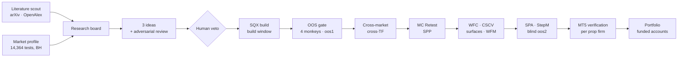

# AlgoProject

**Most backtests are search results, and most search results are selection artefacts.
This pipeline is built to reject them.**

AlgoProject takes a trading idea from a published paper, or from a measured market anomaly, to a
strategy verified trade by trade in MetaTrader 5. Every step in between is a hypothesis test against
a null model built for that question. StrategyQuant X generates and re-runs the backtests, Python does
the inference, and a team of Claude Code agents runs the chain unattended. They work under guardrails
written in code, so automation cannot quietly weaken the statistics.

```
266,530 strategies generated  →  655 survive the out-of-sample gate  (0.25 %)
5,000 strategies with no edge →  0.3–1.5 % pass the same gate         (measured false-positive rate)
```

---

## What is different

| the usual way | here |
|---|---|
| "Profit factor > 1.3, Sharpe > 1" | **A null per question.** Each step states what chance produces on the same market, at the same costs, with the same trade footprint, and reads a z or a p against it |
| Random-entry "monkey" = shuffle the trades | **A ladder of four monkeys** sharing one random stream: timing → +holds → +sizing → free. The gap between two rungs tells *which channel* the edge lives in |
| Cross-market test = run it elsewhere, count wins | **Trades shifted by whole weeks within each year, one shift shared by every market**, so the null keeps cross-market dependence instead of pretending markets are independent |
| Try 10,000 variants, report the best | **Every search is counted** in a global ledger. The trial count N feeds the deflated Sharpe, so 9 survivors out of 10,000 are not read as 9 out of 50 |
| One out-of-sample split, looked at repeatedly | **Three windows, opened in order.** `build` for the search, `oos1` for robustness, and `oos2` locked in code for the final blind test, rolling forward monthly |
| Thresholds tuned until something passes | **Thresholds are data with an author and a date.** They are calibrated on no-edge monkeys pushed through the real criteria. A missing fact returns *limbo*, never *pass* |
| Broker's typical spread | **Pessimistic costs per task.** The widest broker's time-weighted spread, slippage at 35 % of it, and the worse commission and swap of the firms traded. The nulls pay exactly the same costs |
| Optimise first, ask questions later | **Test where to look first.** A market profile runs 14,364 tests before any strategy exists, BH-corrected, with a planted-edge power curve that says what an empty cell does *not* rule out |

## Null models

All nulls live in `engines/` and are shared by every study.

| null | randomises | preserves | draws |
|---|---|---|---|
| `timing` monkey | entry bar | hold length, sizing, trade count, costs | 100,000 |
| `timing_holds` | entry bar, hold length | sizing, count, costs | 100,000 |
| `timing_sizing` | entry, hold, volatility sizing | count, costs | 100,000 |
| `free` | when, how long, how big | trade count and costs only | 100,000 |
| windowed monkey | entry within each trade's own calendar window | regime exposure, ATR sizing, spread + slippage | 100,000 |
| footprint monkey | entries, with the strategy's own footprint and clock hours | trading-hours profile; the benchmark of the final stage | 100,000 |
| `block_shift` | whole-week displacement inside regime blocks | weekday-hour slot; the same shift across all markets | 100,000 |
| `regime_strata` | bar within the same volatility quantile and trend sign | the regime | 100,000 |
| `segment_permute` | where the whole run sits | nothing about calendar, order or clustering | 100,000 |
| stationary bootstrap | trade sequence (Politis–Romano) | dependence up to the block length | 100,000 |
| block bootstrap / shuffle | blocks of trades | runs of consecutive trades | 100,000 |
| shared-sign weekly flip | one sign per week, shared by every unit | cross-sectional dependence | 100,000 |
| market-profile null | block-resampled price series | marginal distribution | 100,000 |

The nulls are themselves tested. The weekly flip null has a measured size of 5.1 % and 5.0 % on no-edge
panels. The market-profile block length was chosen by measuring rejection on sign-flipped series
(4.9 % at the 5 % level). Where a null is miscalibrated, the README of its folder says so: the median
statistic over-rejects (13.3 %) on skewed excess.

## Overfitting and multiple testing

| test | used for | where |
|---|---|---|
| **CSCV / PBO** (Bailey, Borwein, López de Prado, Zhu) | probability of backtest overfitting: 16 blocks, 12,870 partitions, read against its own null's 95th percentile | `studies/optimisation/cscv/` |
| **Deflated Sharpe**, expected max-Sharpe over N trials | Sharpe corrected for the counted search | `core/surface/plateau.py` |
| **PSR, MinTRL** | is the track record long enough to tell skill from noise | `core/significance.py` |
| **Hansen SPA**, **Romano–Wolf StepM** | the final joint blind test on `oos2` against buy-and-hold, Politis–White block length | `engines/inference/snooping/` |
| **Benjamini–Hochberg**, **Storey π₀** | FDR over the 14,364-test market profile and over populations | `engines/inference/` |
| **Benjamini–Yekutieli** | attribution of what breaks a strategy under correlated perturbations | `studies/breakage/mcRetest/` |
| **Local FDR**, empirical null (Efron) | how many survivors a population of no-edge strategies would leave | `engines/inference/localfdr.py` |
| **WFC**, walk-forward correlation | does in-sample rank predict out-of-sample rank? Spearman ρ against a weekly flip null | `studies/optimisation/wfc/` |
| **WFM**, walk-forward matrix | does re-optimising pay? 30 cells, median `oos2` excess against a shared-sign flip null | `studies/optimisation/wfm/` |
| **Parameter surface** | plateau or spike? Latin-hypercube variants, Sobol indices of a fitted quadratic against a shuffled-metric R² | `studies/optimisation/cloud/` |
| **Market surfaces** | is the variant order stable across markets? | `studies/optimisation/marketSurfaces/` |
| **MC Retest, SPP** | about 1,000 full re-runs per perturbed input; System Parameter Permutation as a map, never a filter | `studies/breakage/` |
| **Negative control** | no-edge monkeys pushed through the real `criteria.yaml` give the false-positive rate of the whole gate | `studies/screening/falsePositives/` |
| **Planted-edge power** | an edge of known size pushed through the same test gives the power curve and the minimum detectable effect | `studies/research/profilePower/` |

## The sequence

`docs/AgentPDFs/WORKFLOW.md` is the single ordering of the work: 26 steps plus six half-steps.



| steps | test | question |
|---|---|---|
| 1–6 | **idea generation and build** | what to build |
| 7–8 | **OOS gate** | does a build-selected strategy survive `oos1`? A 16-rule cascade: excess over drift, random-entry nulls, homogeneity permutation, block-bootstrap drawdown |
| 9–12 | **cross-market, cross-timeframe** | does the logic travel? |
| 13–16 | **MC Retest, SPP** | what breaks it? |
| 16.5–19 | **parameter surface, WFC, CSCV, market surfaces, WFM** | is it a plateau, does IS rank predict OOS rank, is the selection overfit, does re-optimising pay? |
| 20 | **SPA + StepM on `oos2`** | does it beat buy-and-hold on data nobody has seen? |
| 21–25 | **closing readings** | what is it made of? Ablation and inversion of each condition, a volatility × trend map, a stop from the MAE of winners, edge per unit of cost. Descriptive only: none of these selects |
| 26 | **MT5 verification** | does MetaTrader 5 agree, trade by trade, on each prop firm's own account? |
| after | **portfolio** | prop-firm rules on floating equity rebuilt from M1 wicks, a trade-level Monte Carlo, and the expected value of a bank of funded accounts |

## Portfolio: 4D Chess

A prop-firm funded account is not capital. **It is an option bought for a fee:** the loss is capped
at the fee, and the gain is a tail of payouts. A strategy that is excellent with real money can still
have negative expected value here, because a single 5 % day in a year fails the account. So the
portfolio layer does not optimise Sharpe or mean–variance. **It optimises the cash flow of a bank of
accounts:** expected payouts minus expected fees, re-buys included. It is built in four levels, each
standing on the one below:

| level | the board | output |
|---|---|---|
| 0 · material | per-trade floating P&L rebuilt from M1 wicks, reduced to tables of closed P&L, floating P&L, day low and day high, one row per firm-server day | the equity the firm actually sees |
| 1 · one game | one account as a numba state machine over those days, running the firm's exact rules from its catalogue (static, trailing and end-of-day trailing floors, daily loss, minimum days) | P(pass), time to pass, *which* rule kills it |
| 2 · the bank | accounts bought one after another along **one long market path**. The next account is bought the day after the last one fails | the bank's EV and its cash drawdown (median, p90, p99) |
| 3 · the choice | plan × add-ons × risk per phase × re-buy policy × portfolio | the plan to buy, or **"none"** |

What makes it non-trivial:
- **Firms test floating equity at specific times.** SQX reports how deep an adverse excursion went,
  not when it happened. The floating path is therefore rebuilt from M1 wicks. On real trades it
  matches SQX's MAE on 100 % of 2,094 trades and its MFE on 99.9 %.
- **A portfolio's worst moment is not the sum of its members' worst moments.** Day loss is measured
  on the combined floating equity, minute by minute, so drawdowns that do not coincide are not
  double-counted.
- **Accounts fail together.** Multiplying failure rates assumes independent accounts. Walking one
  shared path keeps the correlation that real accounts on the same portfolio have.
- **Risk per trade is searched, not fixed.** P(pass) rises with risk, flattens, then falls: an
  inverted U. Risk is searched separately for the challenge phase and the funded phase.
- **Three Monte Carlos, and the most pessimistic one decides.** The first resamples trades
  independently. The second resamples blocks of trades synchronised across strategies. The third
  resamples blocks of days. The block length is estimated with Politis–White, then swept over 5, 10,
  20 and 40 days.
- **The edge is cut, and compared with a monkey.** The edge is cut to 100, 75, 50, 25 and 0 %, and the
  breakeven cut is searched. At 0 % the strategies trade random entries. What gets reported is the
  portfolio's EV minus the monkey's EV.
- **Selection is honest by construction.** The search reads only `build`. A genetic search runs over
  cliques of a correlation graph, about 1,500 to 1,860 combinations per second on 48 cores. Every trial
  is a ledger row, and the risk dimensions count as trials. The winner is judged as a percentile
  against the same selection run on random combinations, and its Sharpe is deflated by the ledger's N.
- **Coarse to fine.** The search runs on M5 blocks, 20 ms per 10-strategy portfolio. The finalists are
  re-run on M1, 224 ms each. The bank simulation evaluates 2,610 configurations over
  10,000 paths × 504 days in 86 s.

Code: `portfolio/common/construct/` covers equity, search, Monte Carlo, weights and verdict.
`portfolio/funded/` covers the firms' rules, the bank simulation and the decision. A separate
trade-level Monte Carlo, `portfolio/common/monteCarlo/`, stress-tests order, composition, execution,
calendar regimes and PSR against a random trader of the same footprint.

## Latest performance upgrade

Statistics this heavy are only worth running if they are fast. Each speed-up below was measured on the
same machine and the same data, before and after.
`perf/` holds the catalogue, which exits non-zero on a regression.

| workload | before | after | speed-up |
|---|---|---|---|
| Monkey report: 757 strategies × 4 rungs × 2,500 draws | 569 s | 11 s | **51×** |
| Strategy-path Monte Carlo: 36 strategies × 20,000 paths | 477 s | 27 s | **18×** |
| IS/OOS filter report, 10,000 strategies | 38.7 s | 3.2 s | **12×** |
| Cross-market null, 96 × 9 markets (`verdict.csv` byte-identical) | 755 s | 52 s | **14×** |
| Null kernel, cost per valuation on real trades | 64.4 ns | 3.1 ns | **21×** |
| Reading a databank: 10,000 strategies, 7.27 M orders | 38.6 s | 7.8 s | **5×** |
| Post-build review: 3.0 M trades, export and harvest | 418 s | 80 s | **5×** |

How the speed-ups were made:
- **Null kernel.** The random-entry null runs as a single-pass numba kernel. PCG64 is re-implemented
  inside numba and produces the identical stream (2.24 ns against 3.15 ns per uniform). Branches are
  rewritten as selects, bit-identical.
- **Load balancing.** Work is spread with longest-processing-time load balancing. On 48 cores,
  200 strategies × 9 markets at 10,000 draws take 135 s of wall time for 6,121 s of CPU.
- **Databank reader.** A custom binary reader, the `.abk` format, replaces SQX's CSV exports.

A full null now costs about 1/90 of one SQX robustness step. Funded-account simulation evaluates
1,305 configurations on 2,000 × 1,250 paths in 4.4 s.

## Run by agents, under guardrails written in code

One person owns the decisions. Fourteen specialist agents run the work, each with a written contract
in `.claude/agents/` and the cheapest model that can do it:
- **Opus** designs: ideas, templates, block palettes, research direction.
- **Sonnet** executes and audits.
- **Haiku** sweeps.

What keeps them honest is enforced, not requested:
- **A pre-execution hook parses every shell command an agent issues.** The hook is `.claude/hooks/guard.py`.
  It parses pipes, subshells, heredocs and `bash -c`. It blocks the commands that destroy work, and
  it blocks any commit or branch the human has not approved. It has its own known-answer test.
- **Lint and test gates.** Lint runs after every edit. An agent cannot end its session while the
  tests of the files it touched are red.
- **The holdout is locked in code.** Autonomous agents cannot read `oos2` before the final stage.
- **Ambiguity is a hard stop.** "Crosses above the Keltner": the upper band or the middle line? The
  agent lists the readings and asks. A silent assumption burns CPU that does not come back.
- **No forcing past a failure.** A failing step gets three tries, then a report. An agent never edits
  a threshold to get past one.
- **Adversarial roles.** An `ideaReviewer` attacks each idea before any compute is spent. A `reviewer`
  reads only the diff, never the author's reasoning. A nightly audit → document → fix loop leaves its
  fixes uncommitted for human review.
- **Literature extraction is anchored.** Every field of a rule taken from a paper must quote the
  source, and the quote is verified verbatim against the stored text.
- **Institutional memory.** `knowhow/` holds about 430 single-fact cards. Each claim is tagged
  🔬 tested, 📓 from logs or 🤔 inferred, and is written in the same task that found it.

## Running it

The whole workflow, steps 5 to 26, is one unattended command: `bin/workflow.sh`, run through the
`/workflow` skill.
- **SQX setup:** one GUI and two headless workers with their own ports, heaps and owner locks
  (`docs/SETUP-NEW-MACHINE.md`).
- **MetaTrader 5:** runs under Wine (`mt5/README.md`).

| folder | holds |
|---|---|
| `engines/` | resampling, null models, regimes, inference |
| `studies/` | every question asked of a strategy or a population, by workflow family |
| `ledger/` | the global search ledger and the frozen thresholds |
| `pipeline/` | one candidate in, one verdict out, unattended |
| `sqx/` · `mt5/` | driving StrategyQuant X · MetaTrader 5 under Wine and its verification |
| `portfolio/` | portfolios, trade-level Monte Carlo, prop-firm simulation |
| `perf/` | the performance catalogue and its regression check |
| `ui/` | the desktop window over a local FastAPI daemon |
| `.claude/` · `knowhow/` | agents, skills and hooks · their institutional memory |

Contributing, human or agent, starts at `CLAUDE.md`, then `CODESTYLE.md` and `CONTRIBUTING.md`.
